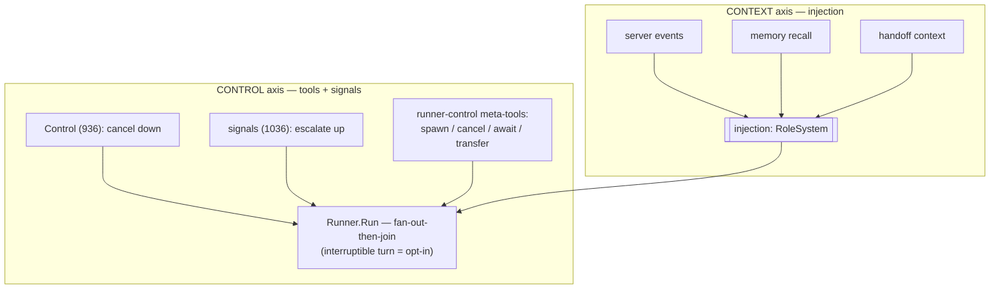
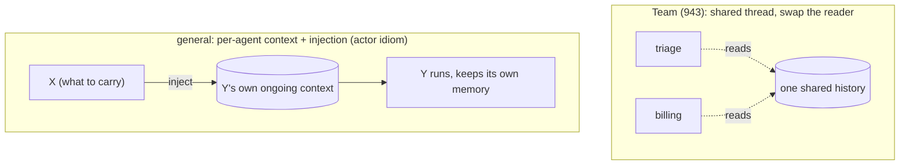

# Agent Composition: multi-agent over one Runner

This page maps mcpkit's multi-agent story (Phase 3, epic 927).
`docs/AGENT_DESIGN.md` covers the single-agent host loop, and
`docs/AGENT_MEMORY_FLOW.md` covers memory. Some of this design is built. The
rest frames the follow-ups, and the text calls out which is which inline.

Multi-agent is not a new engine. It is **two axes** around the same stateless
`Runner`. One axis is how *context* gets into a turn, and the other is how
*control* is steered across turns and agents. Sub-agent as a tool, async
sub-agent, handoff, supervision and speculative groups are each a point in
that two-axis space.

The architecture makes the same bet as memory. `Run(ctx, history, emit)` is
a pure function of its inputs, with a deterministic **fan-out-then-join**
shape, and it keeps that shape. Composition wraps the loop and never lives
*inside* it. The interruptible turn is the one deliberate exception, and it
is opt-in, so the default is still pure. Resume, fork, eval and compaction
can compose around `Run` because of that purity.

## The two axes

### 1. Context in: everything is injection

Context reaches a turn in only two ways. The turn is handed `history` +
`Tools`, and it receives **injection** (pre-turn `RoleSystem` messages).
Server events flow through the *same* injection seam, and so do memory recall
and the working-memory summary. **Handoff context** flows through it too, and
that was the key realization. Suppose agent Y needs context to continue.
Giving Y that context is not special control flow. An injection producer
does it.

### 2. Control: tools + signals, in both directions

Execution is steered two ways, and both are already idiomatic mcpkit. Today
the model manages its own async work through the meta-tools
`create_trigger`, `cancel_task` and `subscribe_events`.

- **Down.** An outside caller uses `Control` (issue 936) to cancel an
  in-flight call cleanly, across all outcome shapes.
- **Up.** A child raises a **non-referential** **signal** to its parent, such
  as "escalate" or a custom note. Signals are issue 1165, piece A of 1036,
  and **SHIPPED in PR 1168**. From the child's side, a signal is just a tool
  call (`signal_parent`). The call writes to a ctx-threaded upward sink, and
  the parent reads that sink at the join. The child reports only its OWN
  state and never names a sibling (A7 isolation). The PARENT holds the
  fan-out inventory, and it decides what to do about the other children
  through `RunnerConfig.SignalPolicy` or injection. Signals provide the
  *mechanism*, and the interruptible turn below reacts to them mid-fan-out.
  Item (A) under § Status & sequencing covers the two-key sink and the
  non-referential decision.
- **Model-driven.** The **runner-control meta-tools** are `spawn_agent`,
  `await_agent`, `cancel_agent` and `list_agents`. They are issue 1166,
  piece B of 1036, and **SHIPPED in PR 1169**. They extend the async-control
  plane to sub-agents, so "supervision/orchestration" is *a Runner whose
  tools control other Runners* and not a separate engine. `agent.AgentPool`
  and `NewSpawnSource` back the tools. The pool is in the agent layer, beside
  `AgentSource`, because background runs need the unexported
  depth/scope/detach plumbing. The host adds only thin wiring, and the Runner
  does not change. `AsyncAgentSource` injects results automatically, while
  `await_agent` lets the model pull them. That pull-based path is the
  distinct value of these tools. `transfer_to` still belongs to Team (943),
  and these tools don't duplicate it.
- **Composition-via-tools.** This applies the same principle one level up.
  Tools steer *execution*, and here they also mutate the *graph*. Membership
  is **static today**. `Team` declares its members at construction, so the
  handoff graph is fixed and validated. The deferred extension makes
  membership **model-driven dynamic** (issue 1038). The model would compose
  from an agent **catalog** via `add_agent` / `remove_agent` / `spawn(role)`,
  and the transfer graph would be recomputed as membership changes. Dynamic
  composition gives up the static graph's determinism. A model that grows its
  own tree needs hard bounds, so the depth / budget / handoff caps matter
  *more*.
- **Interruptible turn.** This piece is opt-in. It is issue 1167, piece C of
  1036, and **SHIPPED in PR 1170**. `RunnerConfig.Interruptible` is off by
  default. When it is on, `dispatch` breaks the fan-out join barrier on the
  first mid-flight signal. It cancels the remaining calls, which feed back
  "cancelled by user", and returns partial results. The existing `RunTurn`
  loop then re-plans. The gate keeps the default fan-out-then-join
  deterministic, and only a signal-wired, opt-in turn becomes interruptible.
  Of the three pieces, only this one changes the Runner's structure. Even so,
  `RunTurn` doesn't change, because re-entry already happens in the existing
  post-dispatch loop. C requires A, since C needs a signal to react to.

The 1036 epic split into three separable pieces. **A** is upward signals
(1165), which provide the mechanism and don't break the barrier. **B** is the
runner-control meta-tools (1166), which add an agent-layer pool and host
wiring. **C** is the interruptible turn (1167), the gated exception. A came
first. It defined the signal payload. B and C both use that payload, and so
does the interaction mediator (1157). C needs a signal to react to, so it came
after A. B was independent of both. **All three shipped in PRs
1168/1169/1170, and epic 1036 closed.**

### A note on the third channel: observability (not an axis)

The two axes are about how *context* and *control* move. The Runner's **emit
stream** is a third channel, and it already existed. It is neither context
nor control. The stream is `emit func(Event)`, and it carries the
turn-lifecycle events (`turn-begin`, `tool-begin`, `text-delta`,
`turn-end`). A surface renders those events and a tracer records them. The
stream carries **observability out**, fire-and-forget, and it never affects
execution.

`SubAgentEvent` (942) is this same channel, **nested**. It forwards a
sub-agent's emit stream to the parent's surface, scoped, so the parent can
*render* what the child is doing. It is neither context-in nor control, and
it shouldn't be confused with either.

- It carries `agent.Event` (lifecycle), **not** MCP domain events. If a
  sub-agent subscribes to some event `e1`, that `e1` is injected into the
  **sub-agent's** context, never the parent's. The parent sees only the
  sub-agent's *activity*, meaning its lifecycle events, and never its
  *inputs*.
- The control signals (1036) do not replace it, because it is
  observability. A "stop the siblings" signal is not a render event. The two
  may share one upward child→parent pipe, but they have different consumers.
  A surface renders the events, and the Runner acts on the signals.

## The patterns as points in the space

| Pattern | Context axis | Control axis | Status |
|---|---|---|---|
| **Sub-agent as tool** (`AgentSource`) | isolated fresh slice (the `task`) | sync, blocking `Call` (answer this turn) | built — 941 |
| **Nested events** (`SubAgentEvent`) | — | child's stream surfaces up, scoped (envelope) | built — 942 |
| **Supervision** | each sub-agent an isolated slice | a Runner whose tools are `AgentSource`s | built (941 + `MultiSource` already cover it) |
| **Handoff** (`Team`) | shared thread today; general = inject-into-target | transfer tool + swap/schedule the active agent | built minimal — 943 |
| **Async sub-agent** | result injected on a later turn | spawn tool + ack now (task-backed) | deferred — 1035 |
| **Speculative group** (early-cancel / dynamic spawn) | partial results | signals up + `Control` down + interruptible turn | deferred — 1036 |
| **Fan-out ergonomics** (map/gather) | N isolated slices | Runner's built-in parallel dispatch | deferred — 1033 |

Two orthogonal knobs recur across the rows. **Context isolation** chooses
between a fresh slice, a shared thread, and injection into a persistent
context. **Control timing** chooses between blocking this turn, running async
and injecting later, and interrupting on a signal.

## Mixing models

There is no separate multi-model machinery. **Every `Runner` has its own
`Provider`**, so composing models is just composing agents. Suppose a heavy
supervisor delegates to cheaper sub-agents. The supervisor is a `Runner` on
one model, and its `AgentSource`/`TeamMember` children each set a
`RunnerConfig.Provider` on another. To route the hard subtask to the big
model and the bulk to a small one, you hand each child a different provider.
That choice is an axis-agnostic config property, not a composition
primitive.

Switching models *within* a single conversation uses a different seam. That
seam includes `ConnectionRegistry` + `providerSwitch` (the `/provider`
command) and `FailoverProvider` (primary/backup with cooldown). It also
includes the deferred per-turn/per-role routing policy (issue 991). Across
agents, each `Runner` has its own provider, as described here. Within one
agent, the provider switches through that seam.

## Handoff, two ways

Handoff moves two things. It moves **(a) context**, because the specialist
needs to know what happened. It moves **(b) control**, because the specialist
now runs and owns the next response. Axis 1 handles (a), since handoff
context is just an injection producer. Axis 2 still handles (b), since
*something* must decide "run Y next." So
**transfer = inject-context-into-Y + schedule-Y**. We already have the
primitives for both, so no bespoke swap engine is needed.

- **Team (built)** is the minimal concrete handoff. It uses a shared thread
  and swaps which stateless Runner reads it. `Config.Team` (1042) wires it
  into the host. `App.RunTurn` drives `Team.RunTurn` instead of the single
  Runner, and the **active agent persists across user turns**. Control
  remains with the agent it was transferred to, and doesn't re-route from
  Start each turn. Team mode replaces the single main agent, so it is
  mutually exclusive with that agent's memory / sub-agents / fan-out.
  Integrating those into team members is deferred. `OnHandoff` is reported as
  a `HostHandoff` event, and `examples/agents/kitchen-sink` demos it
  (`just team`).
- **The general form** gives each agent its *own persistent context* and
  makes transfer an **injection** into the target. This is the actor /
  message-passing idiom, and mcpkit already leans toward it via triggers +
  events. This form is more general, because agents accumulate their
  own memory and collaborate over turns. It also reuses the injection seam
  instead of a swap loop.
- **"While Y is running."** Injecting into an *idle* Y is ordinary pre-turn
  injection, and we have it. Injecting into a *live* turn is the
  mid-turn-injection / interruptible-turn problem, the opt-in from axis 2. So
  the idle case is easy, and the concurrent case needs the interruptible
  turn.

## Why the Runner doesn't change

We keep the turn a pure fan-out-then-join so that everything else can compose
around it. Resume, fork, per-turn eval, and history compaction all wrap
`Run`. They can do that only because it has no hidden state and no mid-turn
re-entry. Imagine a live scheduler *inside* the loop, doing result-watching,
sibling cancellation and dynamic spawning. Ordering would become
nondeterministic, and the turn would no longer be a function of its inputs.
The scheduler would also break A2, which says events must project 1:1 onto a
wire. So the composition primitives all wrap the Runner. We let a turn become
re-entrant in *one* place, the signal-driven interruptible turn, and that
place is explicit and opt-in.

## Sub-agents and memory

The injection-only boundary has a direct consequence. **A sub-agent gets no
ambient parent state, so it has no working memory and no shared store
handle.** It receives exactly what crosses the boundary explicitly (task
arguments + injected context) and returns exactly its answer.

This rule follows from the two axes and isn't a cleanliness preference. A
sub-agent's location is not guaranteed. The in-process `AgentSource` is the
*degenerate co-located case*. The general case is a child on another host,
provider, or model. Shared parent memory assumes co-location. A2
wire-serializability also forbids non-serializable state, such as a pointer
to the parent's store, from crossing the parent-to-child edge. So the
orchestrator has to distill what the child needs to know and pass it down.
`docs/AGENT_MEMORY_FLOW.md` frames the same problem for turn-to-turn memory,
choosing what crosses into the next context under a budget. Here it applies
one level up.

Consequences:

- **A child that needs memory owns it entirely.** The child configures its
  store, persistence, and namespace scheme on its own Runner, and they are
  opaque to the parent. A stateful MCP tool owns its own database with the
  same encapsulation, and its caller neither provisions nor knows that
  database. A code-cleanup sub-agent that remembers its past runs sets that
  up itself.
- **The trap.** Suppose you wire a child with
  `WithMemoryNamespaceFunc(a.currentRunID)`. That silently drops the child
  into the *parent's* namespace, and this model explicitly rejects that. A
  child's memory is never addressed by the parent's run id.
- **Hierarchy** means a parent recalling across its children's memory, and it
  is deferred. It needs a prefix/hierarchical namespace query. The
  `MemoryStore` seam doesn't have one, since it matches exactly today. Even
  with that query, hierarchy would be a query over serializable results, not
  shared mutable access.
- **We keep `AgentSource`, and we contain colocation instead of removing
  it.** `AgentSource` implements the location-independent `ToolSource`
  contract in-process, as the zero-serialization fast path. A remote
  sub-agent is a *sibling* implementation of the same seam. It is largely "a
  sub-agent published as an MCP server, reached through the existing
  server-tools `ToolSource`". In-process, ctx threads depth/budget,
  cancellation, and the nested event stream for free. The remote
  implementation adds carrying that composition metadata over the wire. That
  metadata is the surface of async sub-agents (1035), upward signals (1036),
  and dynamic composition (1038). Imagine a child that reads its parent's
  memory while co-located. Moved behind the wire, it would lose that access
  and behave differently. Enforcing the no-shared-memory rule now, while
  everything is co-located, keeps the local and remote implementations
  interchangeable from the parent's side.

Decision captured in issue 1151; enforced by constraint A7.

## Server-advertised agents (experimental)

A server can host specialist agents and advertise a roster of them. A
supervisor builds each one *locally* and loops its tool calls back to that
server. The MCP Agents WG defines this execution model (epic 1142). It maps
almost exactly onto `AgentSource`, so the bridge is an adapter and needs no
new engine work.

A6 splits the work into two layers.

- **Wire primitive → `experimental/ext/agents`** (issue 1143). This layer is
  the discovery surface. Level 1 is
  `capabilities.extensions[io.modelcontextprotocol/agents]`. At level 2,
  `agents/list` returns a roster of routing tuples with no tool schemas. At
  level 3, `agents/get {name}` resolves one agent's instructions + scoped
  tools. Two-tier skills (#910) have the same progressive-disclosure shape.
  The layer traffics only in protocol objects, so it is not agent-layer.

- **Bridge → `` + `host`** (issue 1144). Consuming a resolved agent needs a
  model + a turn, so this layer is agent-layer.
  - `agent.NewServerAgentSource` is an adapter, and it doesn't depend on the
    experimental module. It takes the *decoded pieces*, which are
    `Instructions string`, `Tools []core.ToolDef`, and a `Backing ToolSource`.
    It returns an `AgentSource` over a child Runner. The child's ToolSource
    is a **scoped source**. It advertises the agent's scoped tool schemas,
    and it dispatches a call to the backing (the advertising server) **only
    for a scoped name**. Suppose the agent's definition did not scope one of
    the server's tools. The child returns `ErrUnknownTool` for that tool.
    That capability boundary limits a server-advertised agent to its declared
    scope instead of the server's whole `tools/list`.
  - In `host/server_agents.go`, the host discovers each connected server's
    roster. It adds a **lazy delegate per agent** (`serverAgentSource`) to
    the main aggregate. `agents/get` fires only on delegation, so the scoped
    schemas resolve into the *child* Runner and never enter the supervisor's
    context. That is the progressive-disclosure win, and catalog-mode skills
    get the same one. Each server can opt out via `ServerConfig.Agents`.
  - Both lookups go through an `agentsclient.Cache`. The cache holds entries
    for the server's `ttlMs`, or for five minutes when the server sends none
    but declares `listChanged`. `notifications/agents/list_changed` drops the
    roster and the aggregate's index, so added and removed agents reach the
    supervisor without a restart. An agent's `modelRoutingHint` picks its
    connection through `ConnectionsConfig.AgentRoles`, and otherwise it runs
    on the active one.

Invocation adds no new wire surface. The child's scoped tool calls go back
over the existing `tools/call`. The WG also defines a server-side
`delegateTool`, which runs the agent on the server, as the alternative path.
The bridge executes on the host side instead. It composes with the rest of
this model, since the depth/budget/scope/signal plumbing all applies to the
delegate unchanged. Issue 1145 tracks observability spans for the extension
itself. The child Runner already has the standard SEP-414 spans/metrics.

## Constraints this model respects

- **A6** (model-facing → ``): `AgentSource`, `Team`, and the future
  control meta-tools are all model-facing, so they live in ``.
- **A2** (wire-serializable events): nesting goes in the `SubAgentEvent`
  envelope, with scope/depth on the wrapper, and `Event` is still flat.
- **A1** (dependency direction): composition is pure `` over `Runner` +
  `ToolSource`; no new upward deps.
- **A7** (no shared sub-agent memory): a persona is built over the
  server-only `serverTools`, never the memory-bearing aggregate. Parent to
  child passes only params + injection. See § Sub-agents and memory above.

## Status & sequencing

**Built (Phase 3):** `AgentSource` (941, agent-as-tool + depth/budget guards),
`SubAgentEvent` nesting (942), `Team` handoff (943), the
`examples/agents/multi-agent` walkthrough (1031, part 1), and
**`FanOutSource`** (1033). `FanOutSource` is the parallel-ensemble primitive.
One tool broadcasts a task to N member sub-agents concurrently and returns
their results aggregated in member order. It reuses `AgentSource` for
per-member depth/budget/scope. The host wires it as `Config.FanOut`, and
`examples/agents/kitchen-sink` demos it.

**Team-in-host (1042):** `Config.Team` drives the App loop, and the active
agent persists across turns. A handoff emits a `HostHandoff` event, and
`just team` demos it. Team mode is mutually exclusive with the single-agent
features. Integrating memory/offloading into team members is deferred.

**`AsyncAgentSource`, the Task form (1035):** the spawn-and-continue
counterpart to `AgentSource`'s blocking Tool form. `Call` returns an ack
immediately and runs the child on a detached goroutine. The goroutine uses
`core.DetachForBackground` because it outlives the turn and makes server
calls. On completion, `OnComplete` delivers the result. The host injects that
result as a `subagent.completed` event, reusing the `tasks_bg.go` Ingest +
trigger path, and the parent picks it up on a later turn. Depth/budget guards
apply at spawn. `SubAgentEvent` still surfaces the background stream. In the
host, `SubAgentConfig.Async` builds it, and `examples/agents/kitchen-sink`
demos it as `deep_researcher`.

**Tool vs Task vs *a real Task*:**
- **Tool** (`AgentSource`): call-and-block, answer this turn. Use it for
  short subtasks when the parent needs the answer now.
- **Task form** (`AsyncAgentSource`): ack-now, result later via injection.
  Use it for long-running or fan-out-and-continue work. But it is **not** an
  MCP task. It has no wire presence and no model-visible poll/cancel. The
  goroutine is ephemeral, so it dies with the process.
- **A real (server-side) task** (`ext/tasks`): use one when you need the
  model to *poll* or *cancel* the background work, or when the work must
  survive a restart. It is heavier, because it needs a task runtime + wire
  support. Both belong to one spawn-and-continue spectrum. The async
  sub-agent is the no-runtime, ephemeral end, and a task is the
  durable/controllable end.

**Deferred, mapped to the axes:**

- Context: handoff-via-injection + per-agent persistent context (the actor
  form above). It generalizes `Team`.
- Control: the 1036 epic is **SHIPPED, and the epic is closed**. Its pieces
  were upward signals (1165, A, PR 1168), runner-control meta-tools (1166, B,
  PR 1169), and the interruptible turn (1167, C, PR 1170). Later work
  depends on these facts.
  (A) Signals are **non-referential**. A child reports only its own state and
  never names a sibling. The parent holds the fan-out inventory and decides.
  The ctx sink in `signal.go` is **two-key**. `dispatchSinkKey` holds a
  dispatch's sink for its own children, and `AgentSource.Call` snapshots
  `parentSinkKey`. A child therefore raises to its *spawner*, not to its own
  dispatch sink, and a grandchild reaches its immediate parent. A single-key
  design had a real bug here, caught before tests.
  (B) The pool is agent-layer, not host, because background runs need the
  unexported `withAgentDepth`/`withAgentScope`/`core.DetachForBackground`
  plumbing.
  (C) Calls run under a cancellable `callBase = WithCancel(parent)`, so a fan
  cancel leaves the *step* ctx live. Cancelled siblings then read "cancelled
  by user" instead of a turn abort. Non-interruptible mode keeps
  `callBase == parent`, so the default path is byte-identical. `wg.Wait()`
  still fills every result slot, because providers require a result per tool
  call.
  A follow-up, the **`preempt` signal kind** (#1176), has shipped. It is
  **parent-granted, not child-authoritative**. Under A7 a child cannot know
  the global goal, so its preempt is only an *advisory* claim. The preempt
  breaks the barrier and cancels the losers only when the parent's
  `RunnerConfig.PreemptGrant` honors it. With no grant, which is the default,
  a preempt is injected like `custom` and the model decides. So a rogue or
  prompt-injected child cannot unilaterally kill its siblings. `escalate`
  still breaks unconditionally, because of its must-handle contract. A
  `custom` FYI signal never breaks. We deferred letting the grant/policy
  select *which* in-flight calls to cancel (#1177). We also deferred a
  per-`TurnRequest` interruptible override, reacting to a partial result
  mid-fan-out, and signals from async sub-agents.
  **`TreeBudget` shipped (1032).** It caps total model **steps** and
  **tokens** across a turn's whole tree, which covers the parent, sub-agents,
  fan-out members and handoff rounds. The cap is ctx-threaded, and the Runner
  consults it per step. The top-level Runner installs it through
  `RunnerConfig.TreeBudget`. The host sets it with `Config.MaxTree*`, and
  agentchat sets it with `--max-tree-*`. Every child run inherits the same
  shared counter through ctx. Exhaustion aborts with `ErrTreeBudget`. In a
  sub-agent, that error becomes a non-fatal `IsError` result. The other cost
  guards are the per-source depth cap, the call-count budget
  (`WithAgentCallBudget`), and per-Runner `MaxSteps`/`Team.MaxHandoffs`.
  `TreeBudget` completes that set.
  **1033 is closed.** It added `AgentSource.InputSchema`, `Structured` output
  and `Team.OnEvent`. `AgentSource.InputSchema` takes a typed subtask in.
  With `Structured` output, a child with a `ResponseSchema` returns coerced
  JSON. `Team.OnEvent` tags member events by active agent name, and they
  render attributed as `HostSubAgentEvent`. 1033 did NOT include map-style
  fan-out, which distributes distinct subtasks. `FanOutSource` broadcasts one
  task to all members. A distinct-subtask variant would be a separate future
  item, if wanted.
- Surface: declarative `host` + agentchat multi-agent config and nested
  rendering (1031, part 2).

**Phase 4 (workflows, 928)** is the *durable* version of the control axis.
Sometimes the schedule/transfer/spawn decisions should be code-driven and
resumable across restarts, rather than model-driven per turn. Then they
become a state machine, and that state machine reuses `TriggerPolicy` for
suspend/resume. The result is the same two axes, made durable.
