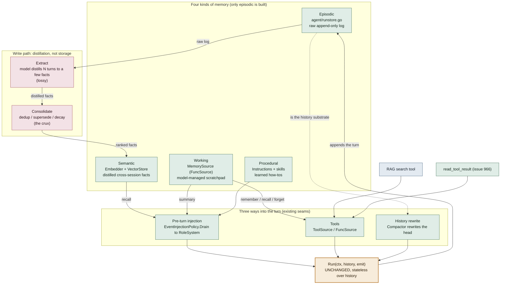

# Agent Memory — how it wraps the Runner

This is the design map for the Phase 2 memory work (`docs/AGENT_SDK_ROADMAP.md` §A). **Phase 2 is now SHIPPED, and epic 926 is closed.** It delivered episodic memory (`RunStore`), offloading, working memory (`MemorySource`/`MemoryStore`), compaction (`SummarizingCompactor`), and semantic recall (`Embedder` + `InMemorySemanticStore` + pre-turn `RecallRelevant` injection). The durable pgvector semantic store (issue 1019) has since merged as `gormstore.SemanticMemoryStore`. The deferred refinements remain, and all of them are filed: a distillation write path, a Scorer/Reranker, the injection arbiter, and an explicit context pipeline. The seams below are real code now, not a sketch.

Persistence keeps the conversation, and memory chooses what crosses into the next one. The `RunStore` is about *not losing* things. Memory is about *choosing* things. It picks a tiny subset of everything ever known to enter the next model call, under a finite budget.

A turn already has three seams for input: injection, tools, and a history rewrite. The design bets that every memory type can feed the turn through one of them, so `Run(ctx, history, emit)` never changes. Memory wraps the loop and isn't baked into it.

## Reading the diagram

- The **top band** shows the four memory types. Each has a different home, write path, and failure mode, so the taxonomy is real. **Episodic** memory is the `RunStore`. **Working** memory is `MemorySource`/`MemoryStore`. **Semantic** memory is `Embedder` + `InMemorySemanticStore`. All three are built. Skills + the system prompt partly cover **procedural** memory.
- The **middle band** shows the entry paths, and none of them is a new Runner seam. The working-memory summary and semantic recall arrive as `RoleSystem` messages through a **dedicated host injection step** (`withMemorySummaryLocked`). They do NOT go through `EventInjectionPolicy`. That policy is events-only, and its rename reflects that. **Read is synchronous.** It embeds the user's turn, queries, and injects. The *write* (indexing) is kept off the critical path, and the automatic distillation write path is still deferred (issue 1022). Working-memory ops and offloading arrive as tools, and the model calls them on demand. Compaction uses the Runner's `Compactor` hook before every model call (chakra#7). It rewrites the head of the turn's working messages, and never the record.
- The **spine** is `Run`. It is stateless over history, so resume, fork, compaction and injection all compose *around* it.
- The **write path** starts at the episodic log, which feeds distillation. Storing is trivial. Memory gets hard at **Extract**, which is lossy, and at **Consolidate**, which has to tell a duplicate from an update from a contradiction. Both are still deferred (issue 1022). Today the model fills semantic memory by calling `remember`, and nothing is auto-extracted.

## Why it's a phase, not a weekend

The stores are the easy 20%, since they look like `RunStore`. The other 80% is policy, and policy is model-shaped.

- **No round-trip test.** A store is correct if it is *faithful*, and that is provable. Memory is correct if it is *relevant under budget*. That is fuzzy and task-dependent, and it can only be judged statistically.
- **Silent failure.** A missing memory does not error. It just makes a subtly worse answer. The eval harness (issue 932) is the only way to measure whether recall helps, so it shipped *before* memory.
- **Retrieval is approximate.** Embedding similarity is a blunt signal. Good recall blends semantic match, recency and importance. Retrieve too eagerly and you poison context.
- **Errors compound.** Unlike a store, memory feeds itself. A bad fact gets recalled, shapes an answer, and gets re-consolidated. So the write path's mistakes aren't contained.

## Where RAG and offloading fit

- **RAG is the semantic layer.** Retrieving chunks and then injecting them uses the *same machinery* as semantic recall (`Embedder` + `VectorStore`). So RAG is not a separate primitive, and the memory seams already provide it.
- **RAG today.** RAG has shifted from "pre-baked top-k every turn" to *retrieval as a tool*, which the agent calls through the Tools path. Large context windows plus offloading erode classic RAG. It still wins when the corpus is larger than the context window, or for freshness, citations, and cost.
- **Offloading (issue 966).** Offloading extends the *episodic* layer with on-demand reads (`read_tool_result`). It is lossless, and the cost comes per lookup. It leaves the lossy layers less to guess, so it is the right thing to build before full memory. Refs are named by content (chakra#109). The same output stored twice gets one ref, and the second stub tells the model it has seen this before. Re-reading an unchanged file was the main repeat cost in the dogfood runs.

## Slots beside memory (#279)

Imagine a long turn on Terminal-Bench. At step 3 the model learns that the build needs `make -j1`, and by step 20 a compaction has summarized step 3 away. Working memory doesn't save it. The model could `remember` it, but the summary only goes in once, at the start of the turn, so it can't show a fact written in the middle. The summary also sits in the turn's messages, and a compaction partway through the turn can fold it in too.

Slots (`agent.Slots`, #279) cover that gap. A slot is a named piece of state for one run, such as `plan` or `facts`. Each is a replace slot or an append slot, with a byte cap. `Slots.StepStage` shows every non-empty slot before each model call, after the history, for that call only. So a write at step 3 is in view at step 4, and a compaction never sees a slot, since slots never enter the messages.

A host that writes the slots itself, rather than the model, sets its own opening line with `SlotsConfig.Header`, since the default calls them the model's notes. `SlotsConfig.AsUser` sends them as a user message, for chat templates that refuse a system message after the first (#319).

| | Working and semantic memory | Slots |
|---|---|---|
| What the model writes | Any number of keyed items, through `remember`, `recall` and `forget` | A few slots the host declares, through `write_slot`, and `update_plan` for the plan |
| When the model sees it | Once per turn, before the user message, or when it calls `recall` | Before every model call |
| How much of it | A selection: recall is top-k and the summary is budgeted | All of it, since each slot is capped |
| Compaction | Can fold the turn's summary into a summary | Never touches it |
| Lifetime | The store's namespace, which can be global and outlive every run | The run. Its event log keeps each write, and `RunRestorer` brings the slots back on resume. A new run starts empty |

So memory carries what's worth keeping from one session to the next, and the model chooses what to look up. Slots keep the current task's working state in front of the model on every step. The same fact can belong in both, and nothing stops a host from writing it to each.

In the diagram, slots would sit on the "pre-turn injection" path as working state, injected before every call rather than once per turn. They stay out of the four kinds of memory. The working-memory summary still has the once-per-turn problem slots fixed for the plan. Rendering it on every call too would fix that, and it could happen without merging the two.

## Prior art & interface extensibility

Memory design has two camps. Working memory's `remember` / `recall` / `forget` verbs are not idiosyncratic. They are a minimal version of the **agent-self-edited** camp.

- **Model-managed** (ours). The agent decides what to keep by calling tools. Examples are Letta/MemGPT (`core_memory_append` / `archival_memory_insert` / `archival_memory_search`) and LangChain LangMem (`manage_memory` + `search_memory`).
- **Pipeline-managed.** A background LLM step extracts and consolidates facts from the raw conversation, and the agent never explicitly remembers. Examples are Mem0, whose `add()` runs an ADD/UPDATE/DELETE/NOOP decision internally, and Zep, which does temporal knowledge-graph extraction. This camp matches the **write path** above (Extract → Consolidate). It complements the tool surface and doesn't replace it.

The table lists primitives that other systems expose, and our plan for each.

| Primitive | Who | Our plan |
|---|---|---|
| Semantic `search` with a relevance **score** (vs substring list) | Mem0, LangGraph `BaseStore.search`, Letta archival, Zep | Issue 940. `ListMemoriesRequest` already carries `Query`; the only addition is a `Score` on the returned items. |
| **Namespace / scope** (`user_id`, `agent_id`, `run_id`, session) | Near-universal — LangGraph hierarchical namespaces, Mem0 scoping, Letta per-agent | Issue 1003. We don't have it yet, and it's the most standard of these; it means a `Namespace` field on the request structs. |
| Explicit **`update` / supersede** as a distinct op | Mem0, LangMem | Covered as upsert-by-key today; consolidation is the pipeline camp — defer. |
| **`history(id)`** — how a fact changed over time | Mem0, Zep (bi-temporal) | Nice-to-have for the knowledge-update category; not now. |
| **Tiered**: in-context core blocks vs archival | Letta/MemGPT, Mastra (markdown profile) | `InjectSummary` is "core-lite"; editable core blocks are a bigger design — defer. |
| Memory-as-**filesystem** (`view` / `create` / `str_replace`) | Anthropic memory tool (2025 beta) | This is our offloading / `FileToolResultStore` direction, a different substrate than the working-memory scratchpad. |
| Configurable tool **names** (vs fixed `remember`/`recall`/`forget`) | competitors use fixed names + namespacing | YAGNI. Names are exported constants. If a second in-agent MemorySource or prompt-tuning ever needs it, a variadic `NewMemorySource(store, opts...)` with a name-prefix option can be added without breaking anything. `MultiSource` already collision-qualifies names, so aggregation doesn't need it. |

None of this requires a change to the first cut. The `MemoryStore` seam uses the gRPC-style req/resp struct convention. So `Namespace`, `Score`, a `GetMemory` point-read and `DeleteAll` can each arrive as a new struct field or a new method, without breaking the interface or any backend. `PutMemoryResponse` is an empty struct for the same reason. The store starts minimal on purpose and grows additively into the primitives above.

## Sequencing (roadmap §A) — all shipped

issue 966 offloading → working memory + `MemorySource` (938) → eval harness (974) → compaction `SummarizingCompactor` (939) → `Embedder` + `InMemorySemanticStore` + recall auto-injection (940). Phase 2 complete (epic 926 closed).

**The durable semantic store (issue 1019) shipped.** `gormstore.SemanticMemoryStore` in `store/gorm` is the durable, ANN-backed counterpart to `InMemorySemanticStore`. It runs on Postgres + pgvector, with the same `MemoryStore` contract and the same client-side `Embedder`. Unlike the in-memory store, it computes the top-k in SQL (`ORDER BY embedding <=> $query LIMIT k` over an HNSW cosine index). So recall survives process exit and scales past a scratchpad. A namespace column scopes many sessions to one table. The per-request `Namespace` field belongs to issue 1003. agentchat routes a postgres `--session-store` + `--memory-embed-model` to this store, so one spec backs runs, blobs, and semantic memory.

**Session-scoping + durable backends (issue 1003) shipped.** `PutMemoryRequest`, `ListMemoriesRequest` and `DeleteMemoryRequest` gained a per-request **`Namespace`**. Each namespace is one independent scratchpad per session or user, and an empty namespace means the shared default. Recall never crosses namespaces. Every backend honors the field. The two in-memory stores partition their maps by namespace. `gormstore.SemanticMemoryStore` reads `req.Namespace` and falls back to its instance-level `WithMemoryNamespace`. So one table can serve many sessions, or one store can bind to one. There is also a new plain durable backend, **`redisstore.MemoryStore`** in `store/redis`. It stores each namespace as one Redis hash (`<prefix>:<namespace>` → key→JSON), does substring recall, and has an optional per-namespace TTL to GC abandoned sessions. `MemorySource` threads a namespace through `WithMemoryNamespaceFunc(func() string)`. A nil func means the shared scratchpad, as before.

**Admin and inspection are per-store, and free where the substrate is queryable.** The pgvector store is a plain Postgres table, so you can inspect it directly in DBeaver with `SELECT namespace, key, body, created_at FROM agent_memories ORDER BY created_at`. The `body` jsonb holds the `MemoryItem`. The vector column is not meant for eyeballing. For the redis store, run `HGETALL mcpkit.agent.memory:<namespace>`. The in-memory store has no inspection surface by nature. A uniform admin UI over the seam is a later, per-store concern, and not part of the storage backends.

**agentchat session-scoping (issue 1140) shipped.** `MemoryConfig.SessionScoped` is opt-in through `--memory-session-scoped`, and off by default. When it's on, the host passes `WithMemoryNamespaceFunc(a.currentRunID)`, so each RunStore run gets its own scratchpad. Without a `--session-store` it is a no-op with a warning. The 1003 note wanted a lock-safe accessor, and `currentRunID` is it. It reads an `atomic.Value` mirror of `runID`, and a single `setRunID` writes that mirror. `currentRunID` can't call `App.RunID`, because `App.RunID` takes `turnMu`. `RunTurn` holds `turnMu` while the namespace func runs, in both the memory tools and the summary/recall injection. So a `turnMu` read there would deadlock.

**Sub-agents get memory by injection, not through a shared store (issue 1151).** A sub-agent has no working memory by default. If it needs one, the child Runner owns it entirely, with its own store and namespace, and the parent can't see into either. A stateful MCP tool encapsulates its DB the same way. The child never gets a namespace in the parent's store. A child's location is not guaranteed. Shared parent memory would assume co-location, and A2 wire-serializability forbids that. So parent→child goes through params + injection. Hierarchy, meaning parent recall across children, needs a prefix or hierarchical namespace query. The seam doesn't have one, and matches namespaces exactly today.

**Deferred.** A Redis **semantic** (vector) backend is a follow-up. Durable semantic recall is the pgvector store's job today.

**Deferred refinements, all filed.** They are the distillation write path (1022, the Extract→Consolidate loop above), Scorer/Reranker multi-signal ranking (1020), a unified injection arbiter (1024), an explicit context-assembly pipeline (1026), faster cosine (1018), and a LongMemEval dataset loader (1014).
