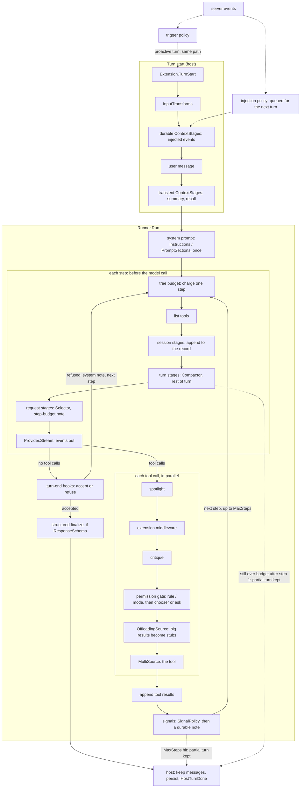

# Where behavior hooks in

We use this map to decide where a new behavior goes, such as compaction, an
injection, a tool rewrite or a new approval rule. A turn passes through five
hook points, in order, and each one has its own shape. To answer most "where
should this go" questions, find the point the behavior needs. Then decide
whether its output joins the record or only the model's view.

Every PR says at the top which hook it uses and why (see `CLAUDE.md`).
Sometimes no hook point on this page fits a change. Then the PR calls that out
as its main decision, and updates this page in the same PR.

## The five hook points

| Point | Runs | What hooks in today | Shape | Code |
|---|---|---|---|---|
| **Turn start** (host) | once per turn, before the Runner | `Extension.TurnStart`, `InputTransform`s (agentsmd's `@rule` mentions), durable `ContextStage`s (event injection), the user message, transient `ContextStage`s (memory summary, recall), `PromptSection`s | one ordered pipeline with two phases | `host/app.go` `RunTurn`, `host/contextpipeline.go` |
| **Before each model call** (Runner) | every step | the step chain: `Compactor` (turn scope), `Selector` (request scope), then `StepStages` such as the host's step-budget note and its step routes (`connections.stepRoutes`), then extensions' `StepStages` (agentsmd's instruction files found mid-session), and `NewStuckDetector` where a caller adds it (#278); also the tree budget | one ordered chain, run by scope: session, turn, request | `stepstage.go`, `runner.go` `Run` |
| **Around each tool call** (Runner) | every tool call, in parallel | `ToolMiddleware`: spotlight, extension middleware, critique, the permission gate (with `ApprovalClassifier`s, `ApprovalRenderer`s, `ApprovalChooser`s, and the skill grants the host passes as a `GrantFunc`, #187); offloading wraps the tool source at the end of the chain | one ordered chain, gate last | `toolmiddleware.go`, `approval.go`, `host/app.go` |
| **Turn end** (Runner) | each time the model answers without calling a tool, before the answer is accepted | `RunnerConfig.TurnEnd` hooks (#150): accept, refuse with a message (a system note, or a user message with `AsUser`) so the loop takes another step, or stop the turn on the refused answer with `ErrTurnStopped` (#222). In the host, an extension contributes them through `Extension.TurnEndHooks`, for the main agent only, and the host keeps a stopped turn in history (#223) | an ordered list, first refusal wins; runs before `ResponseSchema`'s finalize | `turnend.go`, `runner.go` `Run`, `host/extension.go` |
| **Signals and events** | between steps (signals), and between turns (events) | `SignalPolicy`, `Interruptible`, `PreemptGrant`; the host's injection and trigger policies; an `Announcer` extension posts `HostMessage` lines to every surface, a `ProcessReporter` extension streams a running process's output to the surfaces as `HostProcessOutput` and never to the model, and a `TurnEnder` extension hears that a turn ended before the surfaces do, whether it finished, ended partial or failed | separate fields | `signal.go`, `injection.go`, `triggers.go`, `host/events.go` |

Two things are deliberately not hooks. Forking and delegation are tools (a
sub-agent is a `ToolSource`), so the model decides when they happen, as A8
asks. Elicitation is a request/response seam (`ElicitationUI`), not
an event, so it has its own path to the surfaces. A server's sampling request
(`sampling/createMessage`) uses that path too. The host asks the user through
it, then the session's provider answers (`host/sampling.go`).

A surface can also drive an extension's process directly, outside any turn.
An extension that implements `ProcessController` lets the user resize a
terminal process to fit a view and type into it (`App.ResizeProcess`,
`App.WriteProcess`, and the `ResizeProcess` and `WriteProcess` RPCs, #218).
These calls come from the user rather than the model. So they don't pass the
approval gate, and what is typed doesn't enter the model's context. It's the
reverse of `ProcessReporter`, which sends output from the extension to the
surfaces (`host/process.go`).

## A turn, end to end

Solid arrows are one turn. Dotted ones are inputs that arrive from outside a
turn and wait for the next one.

## Record or view

Each hook says how long its messages live. A mix-up fails silently, and the
damage compounds from turn to turn. There are three lifetimes.

- **Session** messages form the record. Each one joins history and persists,
  and every later step and turn sees it. The user message, injected events,
  assistant replies, tool results and signal notes are record.
- **Turn** messages last for the rest of this turn and then drop. The host's
  transient stages put the memory summary and recall here. A compaction summary
  from the Runner's turn stage lives here too.
- **Request** messages reach one model call. A narrowed tool list and the
  step-budget note live here.

The host keeps session and turn apart at turn start (`durable` and `transient`
in `contextPipeline`). The step chain names all three as `StepScope`
(`ScopeSession`, `ScopeTurn`, `ScopeRequest`), runs stages in that order, and
refuses a session stage that rewrites the record instead of appending to it.
`TurnResult.Messages` holds the turn's record. It leaves out messages that
only went to the model's view, so a compaction never shrinks the record.

Suppose a hook writes a view message into the record. The next turn re-injects
it, and later it gets summarized alongside real conversation. Now suppose a
hook keeps a record message only in the view. Then the record loses the reason
the model did something. So a new hook says which one it produces.

## Order inside each point

The order within a point is deliberate. The code gives the reason for each
order next to it.

- At **turn start**, events come first, then the user message, then summary
  and recall, then compaction in the Runner. Recall sits closest to the user
  message because it is the most specific to this turn. See `contextPipeline`.
- Among **tool calls**, middleware that rewrites arguments goes before the
  gate, so the gate and its prompt see the arguments that will actually run.
  Critique also goes before the gate. Critique is automated, so when it refuses
  a call, the call never reaches the human. The gate goes last. Offloading
  wraps the tool source at the end of the chain. So when a result is big,
  middleware that reads it (`AfterToolCall`) sees the stub instead of the full
  text.
- For **signals**, tool results are appended before any signal note. Providers
  pair a tool result with the assistant call right before it.
- At **turn end**, hooks run before `ResponseSchema`'s finalizing call, so the
  finalize only builds a structured answer from an accepted one. A refusal's
  message goes into the record as a `RoleSystem` note in `TurnResult.Messages`,
  because the reason the model kept going has to survive the turn. The refusal
  causes an extra step, and that step counts against `MaxSteps` and the tree
  budget. So a hook that never accepts ends the turn with `ErrMaxSteps` instead
  of looping.

## Choosing a hook

Ask these in order.

1. **Does the model decide when it happens?** Then it's a tool, not a hook.
2. **Is it about the user's input, or context for the whole turn?** Turn
   start. Durable stage if the session should remember it, transient if not.
3. **Does it need to see or change what one model call sends** (messages,
   tools, budget, grammar, which provider answers it)? A `StepStage`, before each
   model call; an extension contributes one through `Extension.StepStages`.
   Pick its scope by how long its output should live. A stage can route a
   call to another provider through `StepView.Provider`. Like the tool set,
   that route has request scope only, so the next step starts back on the
   configured provider. `StepView.Guided` works the same way for the
   decoding constraint. A request stage may switch or clear the turn's
   `ResponseGuided` for one call. `StepView.Generation` works the same way for
   the call's temperature, seed and penalties (#278).
   A stage reads this turn's record on `StepInfo.Turn`, which compaction never
   shrinks, and sends an event to the surfaces with `StepInfo.Emit`. A stage
   that returns an error wrapping `ErrTurnStopped` ends the turn with a
   partial result, before the call, as a turn-end stop does. Any other error
   fails the turn. `NewStuckDetector` uses all three. It splits the turn's
   record into one `StepRecord` per step, so a TurnEnd continuation counts as
   what came back from a step with no tool call.
4. **Does it act on one tool call** (its arguments, whether it runs, its
   result)? Tool middleware, placed by the ordering rules above. When a human
   makes the decision, it goes through the gate, not through new middleware.
   The gate takes an `ApprovalClassifier` to judge a call from its arguments,
   an `ApprovalRenderer` for the question, and an `ApprovalChooser` to approve
   part of a call.
5. **Does it judge whether the turn is finished** (tests still red, a
   required artifact missing)? A `TurnEndHook`, which can send the model back
   with a message, or stop the turn when asking again won't help.
6. **Does it react to something outside the turn** (a server event, a child
   agent)? Signals and events.

## How this point got its chain

Before #7, each feature at the before-each-model-call point had its own
`RunnerConfig` field. Those fields were `Selector`, then `Compactor`, and
`Compactor` ran before step 1 only. Their order was the order of lines in
`runner.go`. Then mid-turn compaction, the step-budget note and mid-turn
injection all wanted this point, so #7 gave it one chain instead of three more
fields. `Compactor` and `Selector` became its built-in first stages and kept
their fields.
Mid-turn injection would be a `ScopeSession` stage, but nothing needs it yet.
