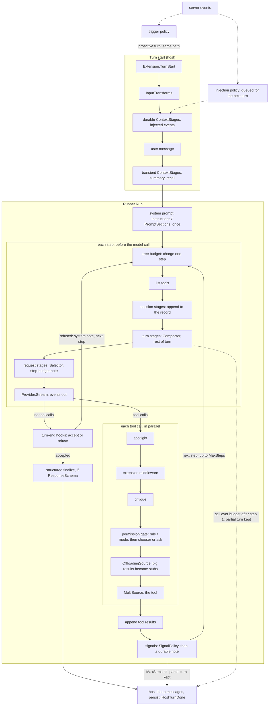

# Where behavior hooks in

This is the map we use to decide where a new behavior goes: compaction, an
injection, a tool rewrite, a new approval rule. A turn passes through five hook
points, in order, and each one has its own shape. Most "where should this go"
questions come down to which point the behavior needs, and whether what it
produces is part of the record or only part of the model's view.

Every PR says at the top which hook it uses and why (see `CLAUDE.md`). When a
change needs a hook point this page doesn't list, that is the decision to call
out, and this page gets updated in the same PR.

## The five hook points

| Point | Runs | What hooks in today | Shape | Code |
|---|---|---|---|---|
| **Turn start** (host) | once per turn, before the Runner | `Extension.TurnStart`, `InputTransform`s, durable `ContextStage`s (event injection), the user message, transient `ContextStage`s (memory summary, recall), `PromptSection`s | one ordered pipeline with two phases | `host/app.go` `RunTurn`, `host/contextpipeline.go` |
| **Before each model call** (Runner) | every step | the step chain: `Compactor` (turn scope), `Selector` (request scope), then `StepStages` such as the host's step-budget note and its step routes (`connections.stepRoutes`), then extensions' `StepStages` (agentsmd's instruction files found mid-session); also the tree budget | one ordered chain, run by scope: session, turn, request | `stepstage.go`, `runner.go` `Run` |
| **Around each tool call** (Runner) | every tool call, in parallel | `ToolMiddleware`: spotlight, extension middleware, critique, the permission gate (with `ApprovalClassifier`s, `ApprovalRenderer`s and `ApprovalChooser`s); offloading wraps the tool source the chain ends in | one ordered chain, gate last | `toolmiddleware.go`, `approval.go`, `host/app.go` |
| **Turn end** (Runner) | each time the model answers without calling a tool, before the answer is accepted | `RunnerConfig.TurnEnd` hooks (#150): accept, refuse with a message (a system note, or a user message with `AsUser`) so the loop takes another step, or stop the turn on the refused answer with `ErrTurnStopped` (#222) | an ordered list, first refusal wins; runs before `ResponseSchema`'s finalize | `turnend.go`, `runner.go` `Run` |
| **Signals and events** | between steps (signals), and between turns (events) | `SignalPolicy`, `Interruptible`, `PreemptGrant`; the host's injection and trigger policies; an extension that implements `Announcer` posts `HostMessage` lines to every surface, one that implements `ProcessReporter` streams a running process's output as `HostProcessOutput` (surfaces only, never the model), and one that implements `TurnEnder` hears that a turn ended (finished, partial or failed) before the surfaces do | separate fields | `signal.go`, `injection.go`, `triggers.go`, `host/events.go` |

Two things are deliberately not hooks. Forking and delegation are tools (a
sub-agent is a `ToolSource`), so the model decides when they happen, which is
what A8 asks for. Elicitation is a request/response seam (`ElicitationUI`), not
an event, so it has its own path to the surfaces. A server's sampling request (`sampling/createMessage`) rides the same path:
the user is asked through it, then the session's provider answers (`host/sampling.go`).

## A turn, end to end

Solid arrows are one turn. Dotted ones are inputs that arrive from outside a
turn and wait for the next one.

## Record or view

Every hook that produces messages says how long they live, and mixing that up
is silent and compounding. There are three lifetimes.

- **Session** (the record): the message joins history, persists, and every
  later step and turn sees it. The user message, injected events, assistant
  replies, tool results and signal notes are record.
- **Turn**: the message is seen for the rest of this turn and then dropped. The
  memory summary and recall (host transient stages) and a compaction summary
  (Runner turn stage) live here.
- **Request**: one model call sees it. A narrowed tool list and the step-budget
  note live here.

The host keeps session and turn apart at turn start (`durable` and `transient`
in `contextPipeline`). The step chain names all three as `StepScope`
(`ScopeSession`, `ScopeTurn`, `ScopeRequest`), runs stages in that order, and
refuses a session stage that rewrites the record instead of appending to it.
`TurnResult.Messages` is everything the turn recorded and nothing it only
showed the model, so a compaction never shrinks the record.

A view message written into the record gets re-injected next turn, then
summarized alongside real conversation. A record message kept only in the view
loses the reason the model did something. So a new hook says which one it
produces.

## Order inside each point

The order within a point is decided, not incidental. Each one has its reason
written next to the code.

- **Turn start:** events, then the user message, then summary and recall,
  then compaction (in the Runner). Recall sits closest to the user message
  because it is the most specific to this turn. See `contextPipeline`.
- **Tool calls:** anything that rewrites arguments goes before the gate, so the
  gate and its prompt see what will actually run. Critique goes before the
  gate because it is automated, so a call it refuses never reaches the human.
  The gate goes last. Offloading wraps the tool source the chain ends in, so
  middleware that reads a result (`AfterToolCall`) sees the stub for a big one,
  not the full text.
- **Signals:** tool results are appended before any signal note, because
  providers pair a tool result with the assistant call right before it.
- **Turn end:** hooks run before `ResponseSchema`'s finalizing call, so a
  structured answer is only made from an accepted one. A refusal's message is
  record (a `RoleSystem` note in `TurnResult.Messages`), because the reason
  the model kept going has to survive the turn. The extra step it causes counts
  against `MaxSteps` and the tree budget, so a hook that never accepts ends the
  turn with `ErrMaxSteps` instead of looping.

## Choosing a hook

Ask these in order.

1. **Does the model decide when it happens?** Then it's a tool, not a hook.
2. **Is it about the user's input, or context for the whole turn?** Turn
   start. Durable stage if the session should remember it, transient if not.
3. **Does it need to see or change what one model call sends** (messages,
   tools, budget, which provider answers it)? A `StepStage`, before each
   model call; an extension contributes one through `Extension.StepStages`.
   Pick its scope by how long its output should live. Routing a call to
   another provider (`StepView.Provider`) is request scope only, like the
   tool set: the next step starts back on the configured provider.
4. **Does it act on one tool call** (its arguments, whether it runs, its
   result)? Tool middleware, placed by the ordering rules above. A decision a
   human makes goes through the gate (`ApprovalClassifier` to judge a call from
   its arguments, `ApprovalRenderer` for the question, `ApprovalChooser` to
   approve part of a call), not through new middleware.
5. **Does it judge whether the turn is finished** (tests still red, a
   required artifact missing)? A `TurnEndHook`, which can send the model back
   with a message, or stop the turn when asking again won't help.
6. **Does it react to something outside the turn** (a server event, a child
   agent)? Signals and events.

## How this point got its chain

The before-each-model-call point used to be a separate `RunnerConfig` field per
feature (`Selector`, then `Compactor` before step 1 only), and their order was
the order of lines in `runner.go`. Mid-turn compaction, the step-budget note and
mid-turn injection all wanted this point, so #7 gave it one chain instead of
three more fields. `Compactor` and `Selector` became its built-in first stages
and their fields stayed as they were. Mid-turn injection is a `ScopeSession`
stage whenever something needs it; nothing does yet.
